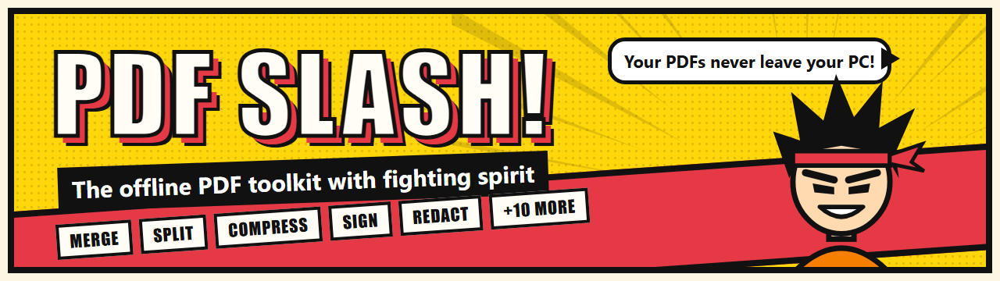
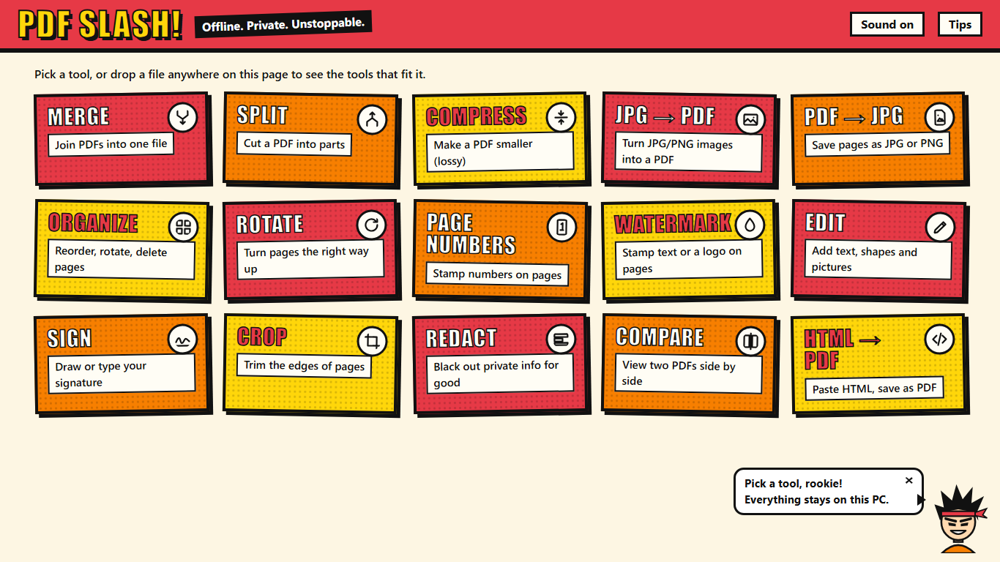
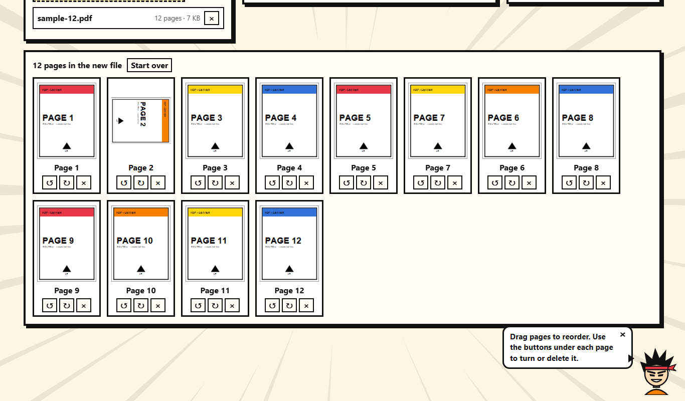
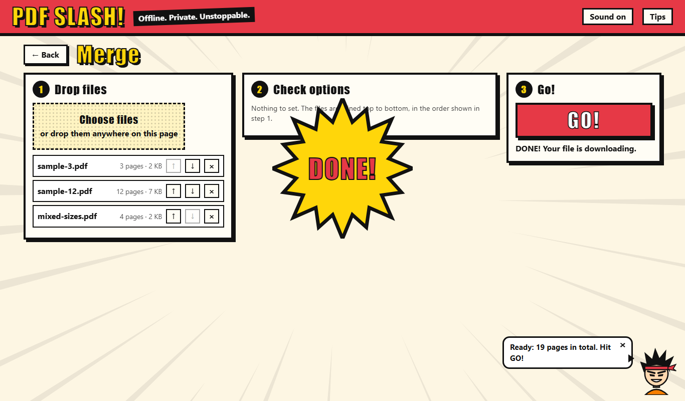
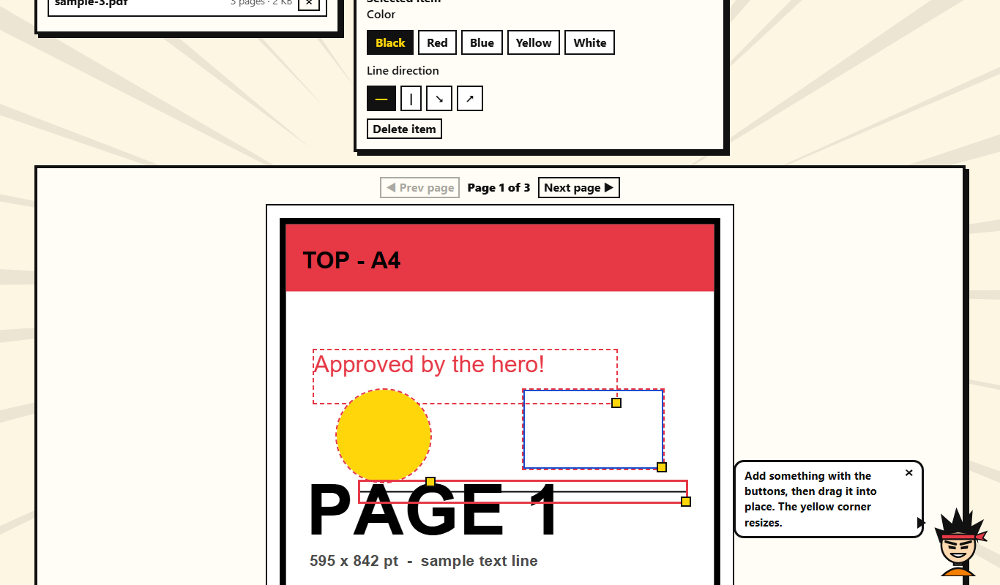
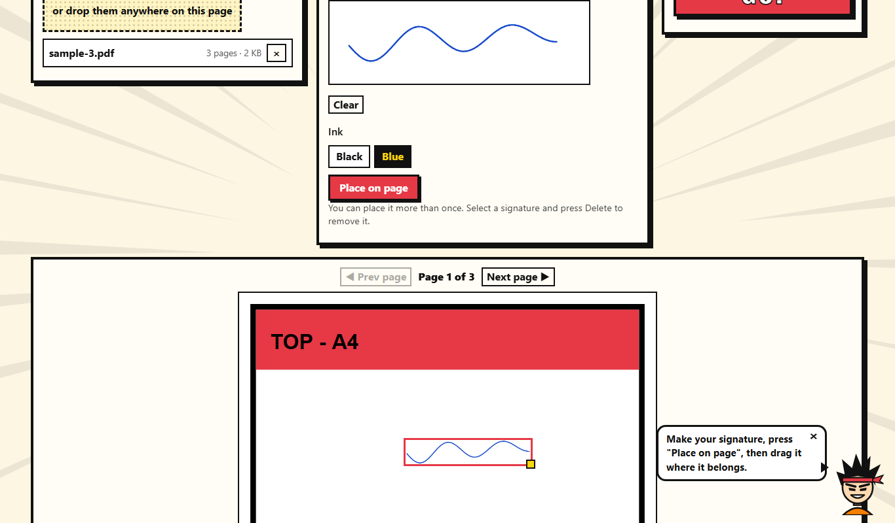
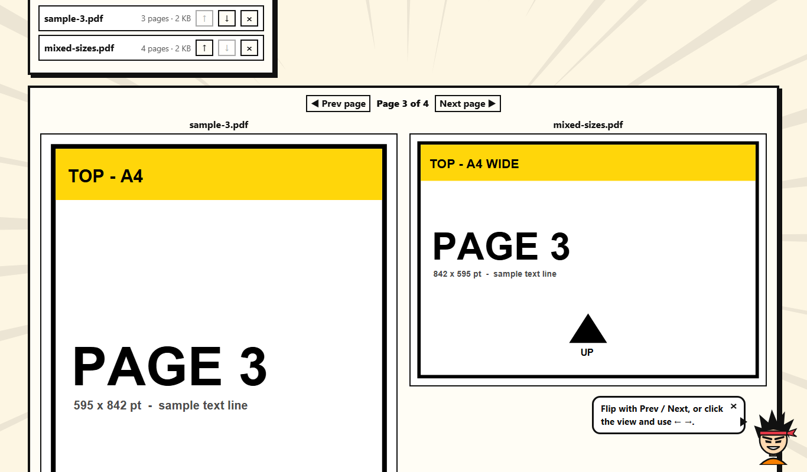

<p align="center">
  
</p>

<p align="center">
  
  
  
  
  
</p>

<h3 align="center">Merge, split, compress, sign and redact PDFs on your own PC.<br>No account, no uploads, no internet. Light enough for low-powered laptops.</h3>

<p align="center">
  
</p>

---

## ⚡ Why PDF Slash?

Most "free PDF tools" upload your files to someone else's server. **PDF Slash never does.** Every page is read, changed and saved inside the app, on your computer.

| | |
|---|---|
| 🔒 **Private by design** | Your files never leave your PC. The app blocks every internet request, so it works with Wi-Fi off. |
| 🪶 **Featherweight** | Plain HTML, CSS and JavaScript. No frameworks, no build step, about 3 MB in all. The home screen loads in well under a second and uses about 0% CPU while idle. |
| 🥊 **Shonen style** | Manga-panel cards, halftone dots, speed lines, a spiky-haired mascot with tips, **DONE!** bursts and punchy sound effects. All original art. |
| 🎯 **Three steps, every tool** | **1** Drop files → **2** Check options (the defaults already work) → **3** **GO!** |
| 🧪 **Tested** | A built-in self-test runs every tool and re-opens each result to check it. |

## 🛠️ The 15 tools

| | Tool | What it does |
|---|---|---|
| 🧩 | **Merge** | Join PDFs into one, in the order you choose |
| ✂️ | **Split** | By page ranges, every page, or pages you pick from thumbnails (several files come as a ZIP) |
| 🗜️ | **Compress** | Make big PDFs smaller by redrawing pages as JPEGs (lossy, and you choose the quality) |
| 🖼️ | **JPG → PDF** | Turn photos and screenshots into a PDF: same size as the image, or A4/Letter |
| 📸 | **PDF → JPG** | Save pages as JPG or PNG images |
| 🗂️ | **Organize** | Drag pages to reorder, turn them, or delete them |
| 🔄 | **Rotate** | Fix sideways pages, either all of them or just the ones you pick |
| 🔢 | **Page Numbers** | `1`, `Page 1 of 9` or `1 / 9`, in any corner |
| 💧 | **Watermark** | See-through text or a logo, once in the center or tiled |
| ✏️ | **Edit** | Add text, boxes, circles, lines and pictures |
| ✍️ | **Sign** | Draw or type your signature and drop it anywhere |
| 📐 | **Crop** | Trim the edges of one page or all pages |
| ⬛ | **Redact** | Black out private info for good: the hidden text is really gone |
| 🆚 | **Compare** | Two PDFs side by side, flipped together |
| 🌐 | **HTML → PDF** | Paste HTML, preview it safely, save it as a PDF |

## 📷 Screenshots

<table>
  <tr>
    <td width="50%"><p align="center"><b>Organize</b>: drag, turn and delete pages</p></td>
    <td width="50%"><p align="center"><b>Merge</b>: three steps, then <b>DONE!</b></p></td>
  </tr>
  <tr>
    <td width="50%"><p align="center"><b>Edit</b>: text, shapes and pictures on any page</p></td>
    <td width="50%"><p align="center"><b>Sign</b>: draw it once, place it anywhere</p></td>
  </tr>
  <tr>
    <td colspan="2"><p align="center"><b>Compare</b>: two PDFs side by side, only the visible page is drawn</p></td>
  </tr>
</table>

## 🚀 Get started (Windows)

1. **Download** this project: the green **Code** button → **Download ZIP**, then unzip it. Or use Git:
   ```bash
   git clone https://github.com/likhith825/PDF-Slash.git
   ```
2. **Build the app:** right-click **`make-app.ps1`** and choose **Run with PowerShell**.
   - It compiles the 30 KB `PDF Slash.exe` with the C# compiler built into Windows. Nothing is downloaded or installed.
   - It also makes a `PDF Slash` shortcut in the folder.
   - For Desktop and Start-menu shortcuts too, run:
     ```bash
     powershell -ExecutionPolicy Bypass -File make-app.ps1 -Desktop -StartMenu
     ```
   - If Windows says the script is blocked, right-click it → **Properties** → tick **Unblock** → **OK**, then try again.
3. **Open PDF Slash** from the shortcut. You get its own window and taskbar icon, and it works with Wi-Fi off.

> 💡 **No build needed:** you can also just double-click **`index.html`** to use PDF Slash in a browser tab (tested in Microsoft Edge). In a tab, sounds start after your first click, because that's a browser rule.

**Needs:** Windows 10 or 11. The app uses the Microsoft Edge WebView2 engine and .NET Framework 4.8, both already part of Windows 11.

## 🎮 Tips

- **Drop a file on the home screen** to see only the tools that fit it.
- **Esc** or **← Back** returns to the tool list.
- In Edit, Sign, Crop and Redact:
  - drag a box to move it, and drag its yellow corner to resize it
  - **arrow keys** nudge it, **Shift + arrows** resize it, and **Delete** removes it
- In Organize, **← →** moves the selected page, **R** turns it, and **Delete** removes it.
- **Sound on/off** and **Tips** sit at the top right, and the app remembers your choice.
- Turn off **Animation effects** in Windows (Settings → Accessibility → Visual effects) and every animation stops.
- Files over 50 MB or 200 pages ask before loading, so a slow PC never gets stuck by surprise.

## 🪶 How it stays light

- **Lazy libraries:**
  - The home screen loads 3 small files and no PDF library.
  - [pdf-lib](https://github.com/Hopding/pdf-lib) and [PDF.js](https://github.com/mozilla/pdf.js) load only when a tool needs them, and both are saved in `vendor/`.
- **One page at a time:**
  - Thumbnails are drawn small, and only when you scroll to them.
  - Each page's memory is freed before the next page.
- **Nothing runs in the background:**
  - Animations are short one-shots (≤ 0.3 s).
  - Sounds are made live by the audio synthesizer, and the audio engine sleeps between them.
- **Measured on the developer's PC:**
  - About 0% CPU at rest.
  - 50 pages compressed in under 2 s.
  - A photo-heavy PDF went from 1.7 MB to 276 KB (84% smaller).

## 🧪 Check it yourself

Double-click **`test-files/selftest.html`**. It runs every tool on the sample files, then re-opens each result in both PDF libraries to check page order, sizes, rotation and text placement. All 38 checks should say **PASS**.

## 📁 What's inside

```
PDF-Slash/
├── index.html, app.js, style.css   the app: home screen, routing, theme, sounds
├── tools/                          one file per tool (merge.js, split.js, …)
├── vendor/                         pdf-lib and PDF.js (loaded only when needed)
├── app/                            the Windows app: PDFSlash.cs + build.ps1 + Microsoft's WebView2 files
├── make-app.ps1                    builds the app and its shortcuts
├── test-files/                     sample PDFs and images, self-test pages
└── docs/                           the pictures in this README
```

## 🗺️ Coming later

- **Heavy tools:** OCR, PDF ↔ Word / Excel / PowerPoint, Protect / Unlock, PDF/A, Repair. These need big downloads, so they're planned separately.
- **Phone version:** an installable web app for Android and iPhone that works offline.

## 🙏 Credits

Built on [pdf-lib](https://github.com/Hopding/pdf-lib) (MIT), [PDF.js](https://github.com/mozilla/pdf.js) (Apache-2.0) and the [Microsoft WebView2 SDK](https://www.nuget.org/packages/Microsoft.Web.WebView2). See [THIRD-PARTY-NOTICES.md](THIRD-PARTY-NOTICES.md).

The mascot, the icon and all the artwork are original to this project.

<p align="center"><b>Drop a PDF and hit GO!</b> 🥊</p>
